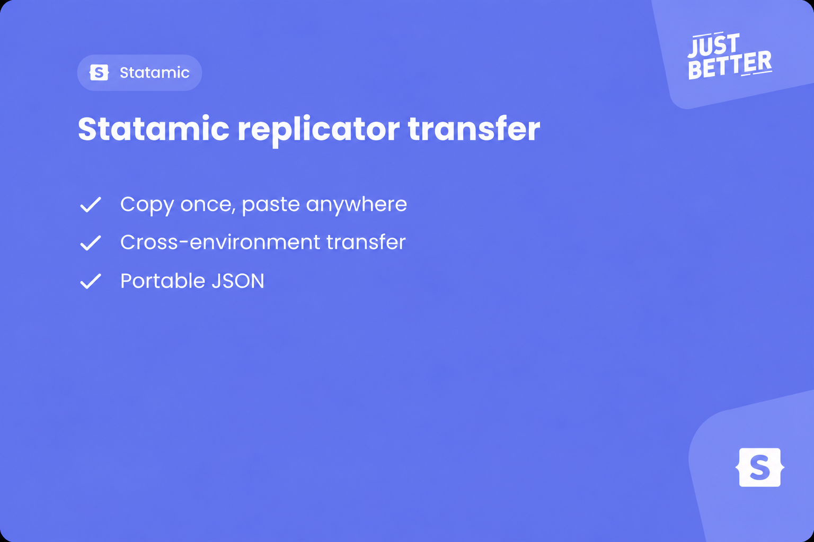

# Statamic Replicator Transfer

<a href="https://justbetter.nl" title="JustBetter"></a>

Transfer Statamic replicator content between entries and environments.

## Requirements

- PHP ^8.4
- Laravel ^12.0|^13.0
- Statamic ^6.0

## Features

- **From staging to production, no copy-paste required** — Export replicator blocks from any entry and import them into any other entry, even across environments
- **Your fields, your rules** — Export and import actions only appear on the replicator fields you configure, keeping the Control Panel clean
- **Inspect it, archive it, ship it** — Transfers use a clean, human-readable JSON file you can version-control or pass between teams
- **Non-destructive imports** — Imported sets are appended to the existing replicator content, nothing is overwritten
- **Works out of the box** — Zero configuration needed; the actions appear automatically on any configured replicator field handle

## Installation

```bash
composer require justbetter/statamic-replicator-transfer
```

## Configuration

By default the export and import actions are available on replicator fields with the `page_builder` handle. Publish the config to add or change handles:

```bash
php artisan vendor:publish --tag=replicator-transfer-config
```

This creates `config/replicator-transfer.php`:

```php
return [
    'handles' => [
        'page_builder',
    ],
];
```

## Usage

### Exporting

1. Open an entry that contains a configured replicator field in the Control Panel.
2. Click the action menu on the replicator field.
3. Select **Export replicator**.
4. An `export.json` file is downloaded to your machine.

### Importing

1. Open the entry you want to import into in the Control Panel.
2. Click the action menu on the replicator field.
3. Select **Import replicator**.
4. Upload the `export.json` file in the confirmation dialog.
5. The imported sets are appended to the existing replicator content.

## Development

Node.js 22+ is required to build the Control Panel assets:

```bash
npm install
npm run build
```

For hot reloading during development, run `npm run dev` in a separate terminal.

## Quality

```bash
composer quality
```

This runs code style checks, static analysis, and the test suite.

## Credits

- [Bob Wezelman](https://github.com/BobWez98)
- [All Contributors](../../contributors)

## Contributing

Please see [CONTRIBUTING](.github/CONTRIBUTING.md) for details.

## Security Vulnerabilities

Please review [our security policy](.github/SECURITY.md) on how to report security vulnerabilities.

## License

The MIT License (MIT). Please see [License File](LICENSE) for more information.

<a href="https://justbetter.nl" title="JustBetter"></a>
